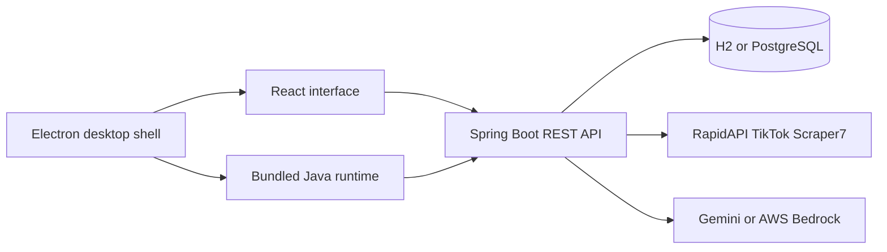

# Architecture

Creator Studio is a React/Vite frontend backed by a Spring Boot 3 / Java 21 service. It uses one workspace without login. The primary workflow performs direct provider requests, persists results and returns them to the UI.

## Backend

Controllers validate requests and delegate to services. JPA repositories persist categories, channels, videos, scripts, reference links, research profiles and view observations. DTOs define API contracts; exception handling returns structured English errors. An internal owner identity preserves legacy foreign keys without exposing authentication.

Provider interfaces separate RapidAPI scraping and Gemini/Bedrock generation. The prompt builder requests complete English dialogue, timing and structured JSON. The parser validates required fields and integer duration before persistence. Production has no mock fallback; mocks are restricted to the test profile. Provider configuration flags do not establish provider health.

Research reports use deterministic keyword matching and saved view observations. They include evidence and limitations, and do not estimate private demographics or a calibrated probability of trending. See [research methodology](../RESEARCH.md).

## Frontend and desktop

The frontend has script studio, channel research and script library views. Drafts are stored in localStorage; persisted library/profile data comes from the backend. Request cancellation and version tracking avoid stale list responses overwriting newer results. The English interface preserves multilingual user and source data.

Electron launches a bundled JRE/backend, binds the service locally, waits for health and opens the UI. Renderer sandboxing and context isolation are enabled. A small preload bridge handles Settings and busy state; the frontend has no Node.js access. API keys use Windows-account encryption. Settings changes restart the local service when no operation is active. A private ASCII-path runtime cache supports installations with Unicode paths.

## Deployment and persistence

Desktop and local profiles use persistent H2. Docker/production can use PostgreSQL. Hibernate currently updates schemas automatically; versioned migrations remain future work. Desktop data lives in AppData, separate from portable binaries. The web deployment is shared and does not synchronize with desktop installations.

SQS background processing and S3 raw archiving remain optional integration paths, disabled by default. Their existence does not imply production-ready queue idempotency, credit handling or AWS end-to-end verification. See [remaining development work](../CREATOR_STUDIO.md#remaining-development-work).

CI verifies desktop utilities, frontend checks and backend unit/integration tests using isolated test databases and provider doubles. Live provider quotas, PostgreSQL upgrades, load and optional AWS infrastructure require separate checks.
