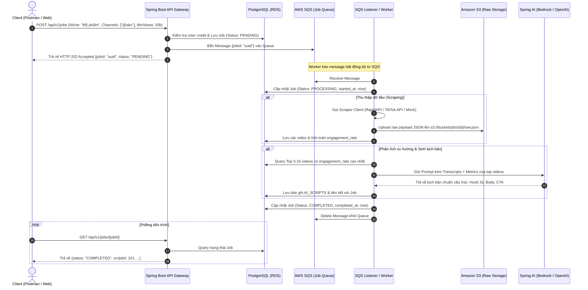

# Software Architecture Document (SAD)
## TikTok Content Intelligence & AI Script Generator

---

## 1. Tổng quan kiến trúc hệ thống (System Overview)

Hệ thống được thiết kế theo mô hình **Phân tầng hướng nghiệp vụ (Layered Clean Architecture)** kết hợp với **Kiến trúc hướng sự kiện bất đồng bộ (Event-Driven Architecture)** thông qua hàng đợi thông điệp AWS SQS.

Mục tiêu thiết kế:
* **Tính độc lập (Decoupling):** Tách biệt tầng tiếp nhận yêu cầu (Web API) và tầng xử lý tác vụ nặng (Scraping + GenAI).
* **Khả năng chịu tải (Scalability):** Tầng Worker có thể scale độc lập (horizontal scaling) khi số lượng tác vụ cào dữ liệu tăng đột biến.
* **Tính chống chịu lỗi (Resilience):** Áp dụng mô hình Dead-Letter Queue (DLQ) và Retry Pattern để xử lý các lỗi mạng hoặc rate-limit từ TikTok/AI providers.

---

## 2. Sơ đồ luồng xử lý bất đồng bộ (Async Sequence Diagram)



---

## 3. Kiến trúc phân tầng Backend (Clean Layered Architecture)

```
com.tiktok.intelligence/
├── config/                  # Cấu hình Spring (Security, AWS, Redis, Swagger, Async)
│   ├── AwsConfig.java       # S3Client, SqsClient, BedrockClient (hỗ trợ LocalStack)
│   ├── SecurityConfig.java  # SecurityFilterChain, PasswordEncoder, JWT Filter
│   ├── RedisConfig.java     # CacheManager, RedisTemplate
│   └── OpenApiConfig.java   # Swagger 3 & OpenAPI Metadata
├── domain/                  # Lõi nghiệp vụ (Domain Entities & Enums)
│   ├── entity/              # User, Category, TikTokChannel, TikTokVideo, AnalysisJob, AiScript
│   └── enums/               # JobStatus, JobType, UserRole, ScriptStatus
├── repository/              # Data Access Layer (Spring Data JPA)
│   ├── UserRepository.java
│   ├── TikTokVideoRepository.java (Custom queries for Top Engagement)
│   └── AnalysisJobRepository.java
├── service/                 # Tầng xử lý logic nghiệp vụ
│   ├── auth/                # AuthService, JwtService, CustomUserDetailsService
│   ├── scraper/             # TikTokScraperService (Interface & Implementations: RapidApi, Mock)
│   ├── ai/                  # AiScriptGenerationService (Spring AI, Prompt templates)
│   ├── storage/             # S3StorageService (Upload raw JSON, presigned URLs)
│   └── queue/               # SqsProducerService, SqsJobConsumerWorker
├── controller/              # Tầng giao tiếp REST API
│   ├── AuthController.java
│   ├── CategoryController.java
│   ├── ChannelController.java
│   ├── JobController.java
│   └── ScriptController.java
└── dto/                     # Data Transfer Objects
    ├── request/             # JobFilterRequest, LoginRequest, RegisterRequest
    └── response/            # JobStatusResponse, ScriptDetailResponse, ApiResponse<T>
```

---

## 4. Ánh xạ Hạ tầng Cloud AWS & Môi trường Local

| Thành phần | Môi trường Production (AWS) | Môi trường Local Dev (Docker) | Ghi chú kỹ thuật |
| :--- | :--- | :--- | :--- |
| **Compute** | AWS ECS Fargate | Java 21 Application Runner | Chạy ứng dụng container hóa |
| **Database** | Amazon RDS PostgreSQL | `postgres:16-alpine` | Quản lý dữ liệu quan hệ, ACID |
| **Message Queue** | Amazon SQS (Standard Queue + DLQ) | LocalStack SQS (`:4566`) | Xử lý bất đồng bộ, retry tối đa 3 lần |
| **File Storage** | Amazon S3 | LocalStack S3 (`:4566`) | Lưu raw JSON metadata từ scraper |
| **Cache / Rate Limit** | Amazon ElastiCache (Redis) | `redis:7-alpine` | Giới hạn số lượng request cào trong ngày |
| **Generative AI** | Amazon Bedrock (Claude 3.5 Sonnet) | Spring AI với OpenAI / Bedrock API Key | Phân tích transcript và sinh kịch bản |

---

## 5. Chiến lược xử lý lỗi & Khả năng chịu lỗi (Resilience Strategy)

1. **Dead-Letter Queue (DLQ) cho SQS:**
   * Khi một job xử lý thất bại (ví dụ: TikTok API bị timeout hoặc LLM trả về lỗi), message sẽ được retry tối đa **3 lần** với exponential backoff.
   * Nếu sau 3 lần vẫn lỗi, message tự động chuyển vào **Dead-Letter Queue (`tiktok-job-dlq`)** để đội ngũ kỹ thuật điều tra mà không làm nghẽn hàng đợi chính.
2. **Circuit Breaker (Resilience4j):**
   * Bảo vệ hệ thống khi dịch vụ bên thứ ba (Scraper / AI Provider) gặp sự cố kéo dài.
3. **Credit Rollback:**
   * Nếu Job rơi vào trạng thái `FAILED`, hệ thống tự động hoàn lại số dư `credits_balance` cho User.
