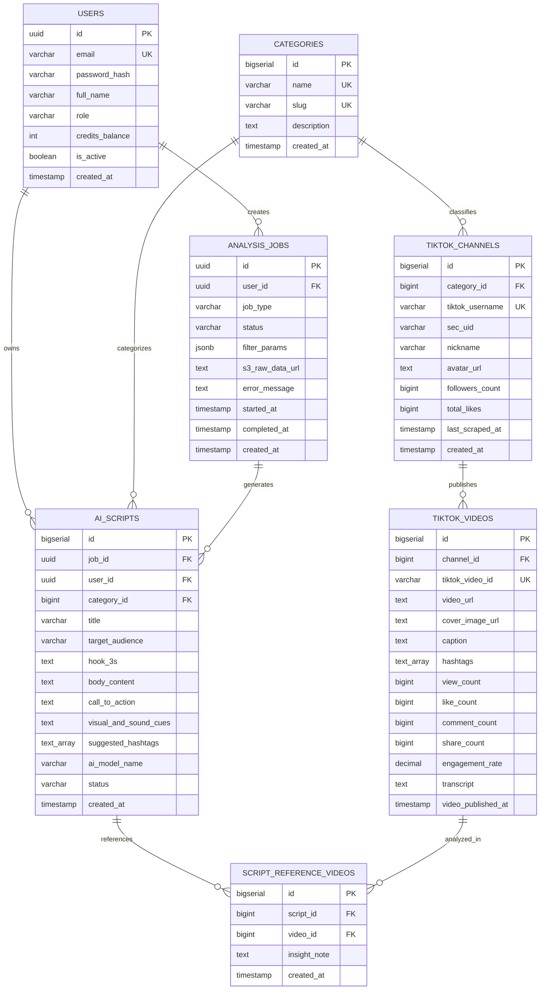

# TikTok Content Intelligence & AI Script Generator - ERD Specification

## 1. Entity Relationship Diagram (Mermaid ERD)

---

## 2. Detailed Entity Explanation & Architectural Highlights

### 2.1. `ANALYSIS_JOBS` (Asynchronous Job Coordination)
* **Purpose:** When a creator filters a niche (e.g. "Beauty & Skincare", top 5 competitor channels, videos exceeding 50k views in the last 30 days), scraping and AI processing can take 15s - 60s.
* **Mechanism:**
  1. Backend API persists an `ANALYSIS_JOBS` record with `PENDING` status and immediately returns `job_id` (HTTP 202 Accepted).
  2. The job message is dispatched into **AWS SQS**.
  3. Background worker polls SQS, executes scraping, uploads raw JSON payloads to **AWS S3**, triggers Generative AI, and marks the job `COMPLETED`.

### 2.2. `TIKTOK_VIDEOS` & `engagement_rate`
* **Engagement Rate Formula:**
  $$\text{Engagement Rate} = \frac{\text{Like} + \text{Comment} + \text{Share}}{\text{View}} \times 100$$
* Indexed via `idx_videos_engagement DESC` to allow rapid querying of the **top 5% high-retention viral videos** within any niche.
* The `transcript` field stores video spoken transcripts/closed captions as high-value few-shot training context for LLM prompt engineering.

### 2.3. `AI_SCRIPTS` (Enterprise Short-form Video Script Structure)
Scripts are structured into 3 distinct, high-converting short-video acts:
* `hook_3s`: High-impact verbal hook delivered in the first 3 seconds to maximize 3s-retention and stop user scrolling.
* `body_content`: Core value delivery with scene-by-scene script lines.
* `call_to_action`: Direct closing CTA (follow, comment, save).
* `visual_and_sound_cues`: Practical director instructions (camera angles, gestures, sound effects, B-roll text overlays).

### 2.4. `SCRIPT_REFERENCE_VIDEOS` (Data Provenance & Traceability)
Many-to-many relationship establishing transparency on which viral competitor videos inspired the AI-generated script, providing full data lineage.

---

## 3. AWS Cloud Infrastructure Mapping

| Database Table / Entity | Target AWS Cloud Service | System Role & Responsibility |
| :--- | :--- | :--- |
| **All Tables** | **Amazon RDS (PostgreSQL)** | Relational, transactional ACID storage. |
| **ANALYSIS_JOBS** | **Amazon SQS** | Distributed asynchronous job queuing and worker dispatch. |
| **s3_raw_data_url** | **Amazon S3** | Durable raw scraping JSON storage, offloading large payloads from RDS. |
| **cover_image_url** | **Amazon CloudFront + S3** | Edge caching and low-latency thumbnail delivery. |
| **AI Generation** | **AWS Bedrock / Google Gemini** | LLM Engine generating structured viral script payloads. |
