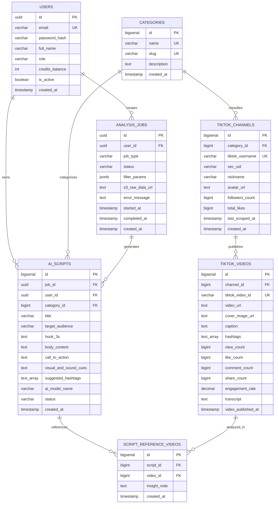

# TikTok Content Intelligence & AI Script Generator - ERD Specification

## 1. Sơ đồ thực thể liên kết (Mermaid ERD)

---

## 2. Giải thích chi tiết các thực thể & Điểm nhấn thiết kế

### 2.1. `ANALYSIS_JOBS` (Trọng tâm kiến trúc bất đồng bộ)
* **Mục đích:** Khi người dùng chọn bộ lọc (VD: Ngách "Mỹ phẩm", chọn 5 kênh tiêu biểu, lấy video trên 50k view trong 30 ngày qua), việc cào dữ liệu và phân tích AI có thể mất 30s - 2 phút.
* **Cơ chế:**
  1. API Backend tạo một bản ghi `ANALYSIS_JOBS` với trạng thái `PENDING` và trả về ngay mã `job_id` cho Frontend.
  2. Backend bắn message chứa `job_id` và `filter_params` vào **AWS SQS**.
  3. Worker kéo message từ SQS về xử lý. Khi hoàn thành, cập nhật trạng thái `COMPLETED` kèm `s3_raw_data_url` (nơi lưu file raw data dạng JSON trên S3).

### 2.2. `TIKTOK_VIDEOS` & `engagement_rate`
* **Công thức tỷ lệ tương tác:**
  $$\text{Engagement Rate} = \frac{\text{Like} + \text{Comment} + \text{Share}}{\text{View}} \times 100$$
* Trường này được đánh Index `idx_videos_engagement DESC` để AI có thể nhanh chóng truy vấn ra **Top 5% video giữ chân người xem tốt nhất** trong ngách làm đẹp để học hỏi cấu trúc.
* Trường `transcript`: Chứa nội dung lời thoại (được bóc tách từ phụ đề gốc hoặc chuyển hóa giọng nói qua speech-to-text). Đây là "nguyên liệu vàng" để đưa vào prompt cho LLM.

### 2.3. `AI_SCRIPTS` (Cấu trúc kịch bản chuẩn TikTok)
Kịch bản không lưu thành 1 đoạn văn chung chung mà được bóc tách theo công thức Video ngắn chuyên nghiệp:
* `hook_3s`: Câu nói hoặc hành động mở đầu gây sốc / tò mò trong 3 giây đầu để ngăn người dùng lướt đi.
* `body_content`: Giá trị cốt lõi, review chân thực, nêu bật vấn đề và giải pháp.
* `call_to_action`: Kêu gọi hành động rõ ràng (mua tại giỏ hàng, follow kênh để xem phần tiếp theo).
* `visual_and_sound_cues`: Gợi ý góc máy quay cận cảnh texture kem dưỡng, hiệu ứng âm thanh ASMR, nhạc trending phù hợp.

### 2.4. `SCRIPT_REFERENCE_VIDEOS` (Minh bạch dữ liệu)
Bảng quan hệ nhiều-nhiều giúp người dùng biết được kịch bản này được AI "học hỏi" và lấy cảm hứng từ những video cụ thể nào, kèm số liệu view/like của video gốc để tạo độ tin cậy.

---

## 3. Tích hợp với Hạ tầng AWS

| Bảng dữ liệu | Dịch vụ AWS tương ứng | Vai trò trong hệ thống |
| :--- | :--- | :--- |
| **All Tables** | **Amazon RDS (PostgreSQL)** | Lưu trữ dữ liệu quan hệ, transactional, đảm bảo tính toàn vẹn ACID. |
| **ANALYSIS_JOBS** | **Amazon SQS** | Đóng vai trò Message Payload chứa ID của Job để phân phối tác vụ. |
| **s3_raw_data_url** | **Amazon S3** | Lưu toàn bộ JSON response cào từ TikTok, giảm tải dung lượng cho RDS. |
| **cover_image_url** | **Amazon CloudFront + S3** | Cache và phân phối ảnh thumbnail video với tốc độ cao. |
| **AI Generation** | **Amazon Bedrock (Claude 3.5 Sonnet)** | LLM Engine nhận transcript từ `TIKTOK_VIDEOS` để sinh ra bản ghi `AI_SCRIPTS`. |
